

<a href="https://misians.github.io/portfolio2026/">
  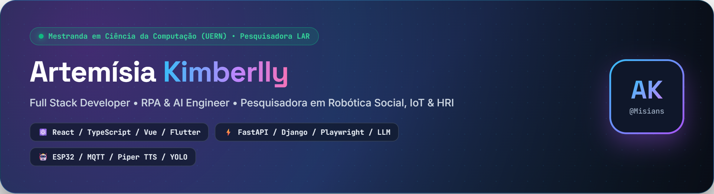
</a>

  

  
  
  
  
  
  
  

 

### 👩‍💻 Visão Geral & Pilares de Atuação

  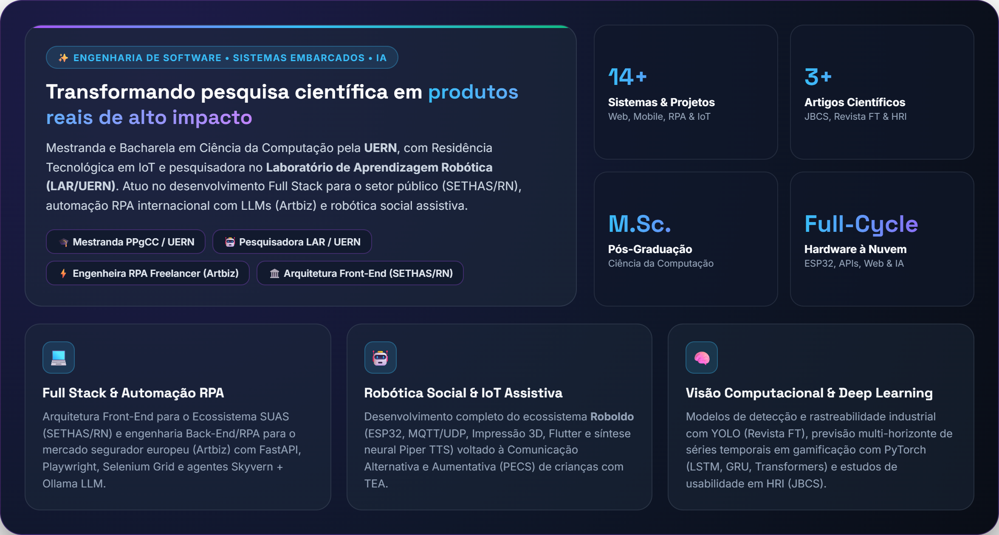

 

### 🚀 Projetos em Destaque (Clique no card para abrir a Demo Online)

  <a href="https://misians.github.io/Roboldo-Game-Perguntas-e-Respostas/">
    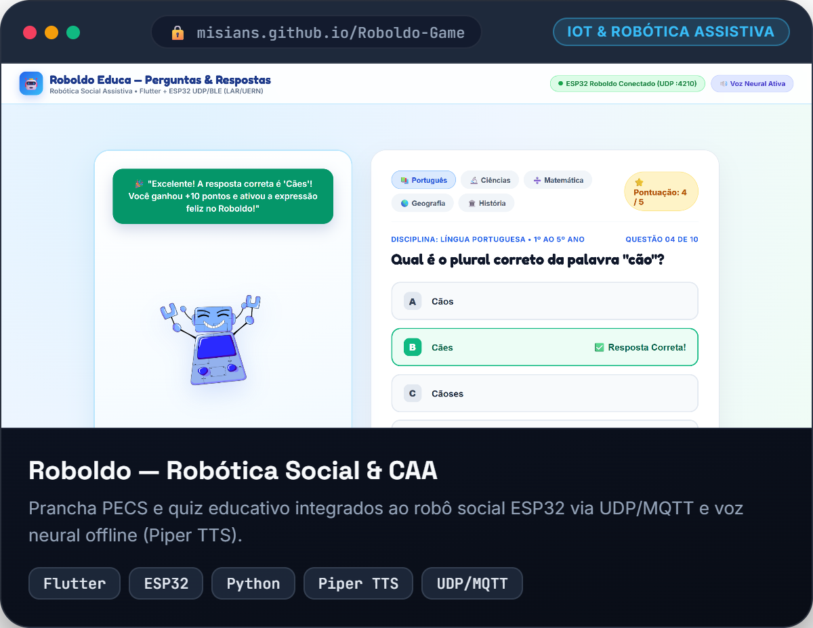
  </a>
  <a href="https://misians.github.io/Inventario-Lar/">
    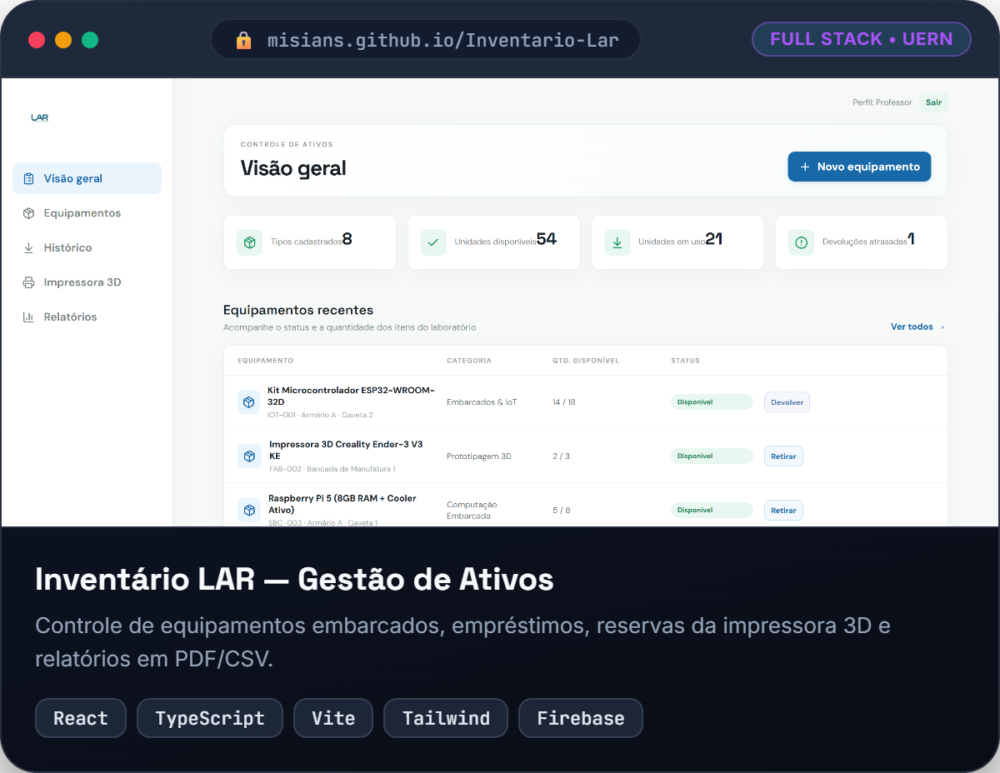
  </a>

  <a href="https://gamificarparaincluir-81675.web.app/">
    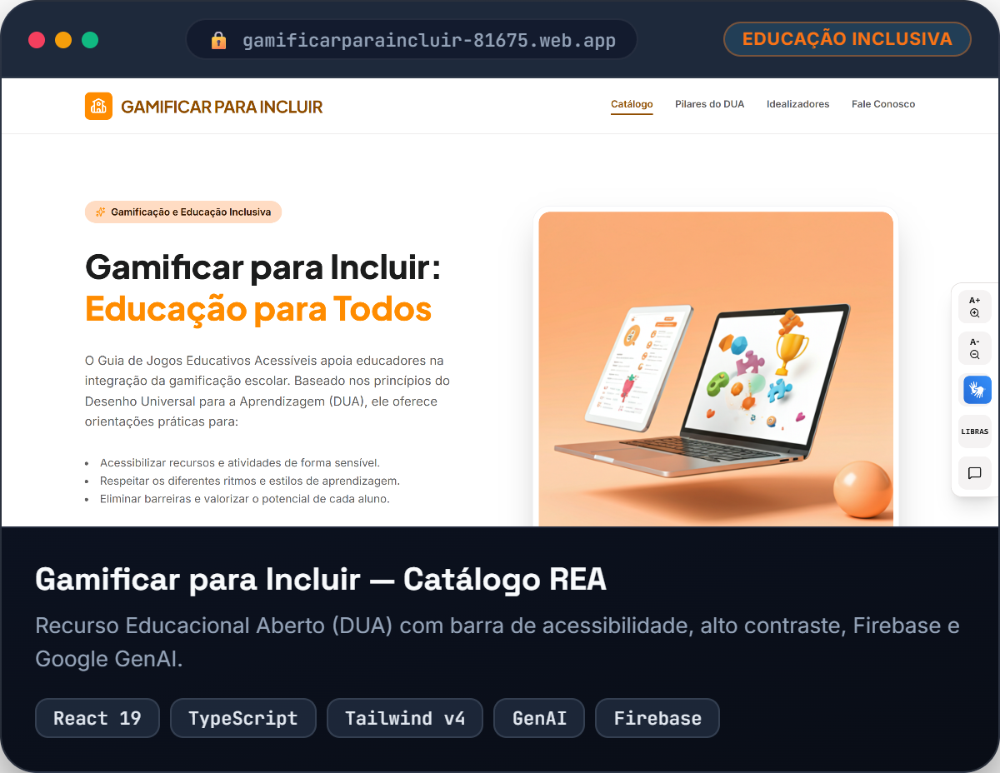
  </a>
  <a href="https://misians.github.io/Sistemas-Operacionais/">
    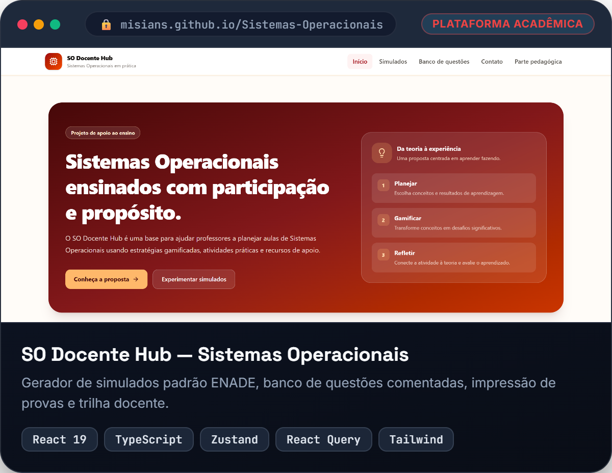
  </a>

  <a href="https://misians.github.io/Irrigador-Automatizado/">
    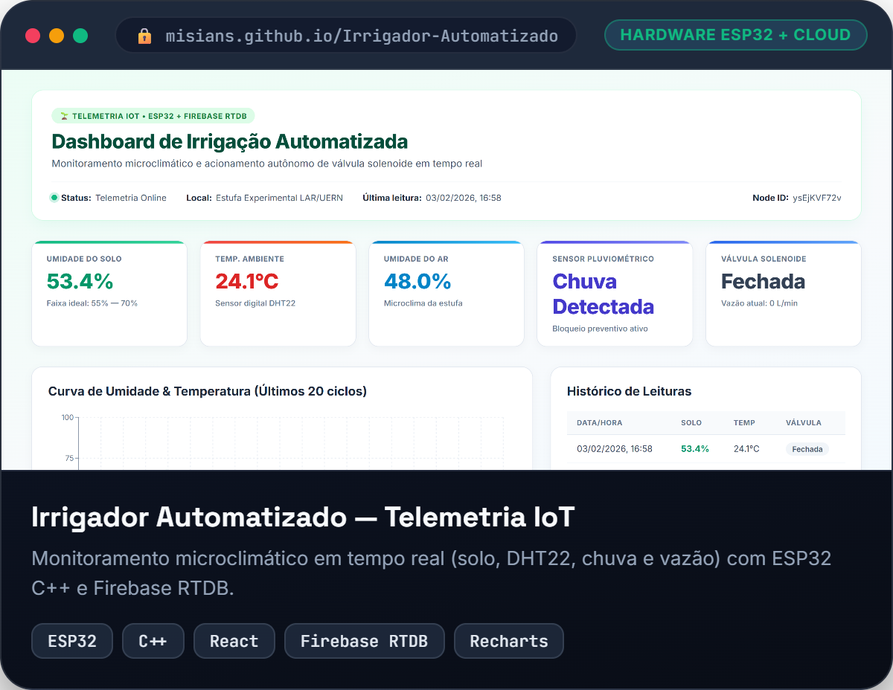
  </a>
  <a href="https://misians.github.io/Site-Abner/">
    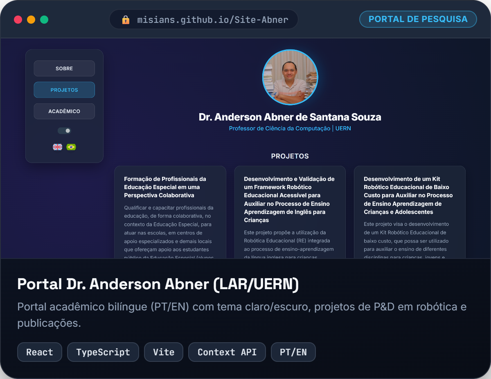
  </a>

  
  
  
  
  
  
  
  

<b>✨ Ver mais 6 aplicações Web & Full Stack publicadas (COIN 2024, ResPets, NanaBaby, Gelato On Ice, FiguresLoja & Ecommerce-Django)</b>

 

  <a href="https://misians.github.io/coin2024/">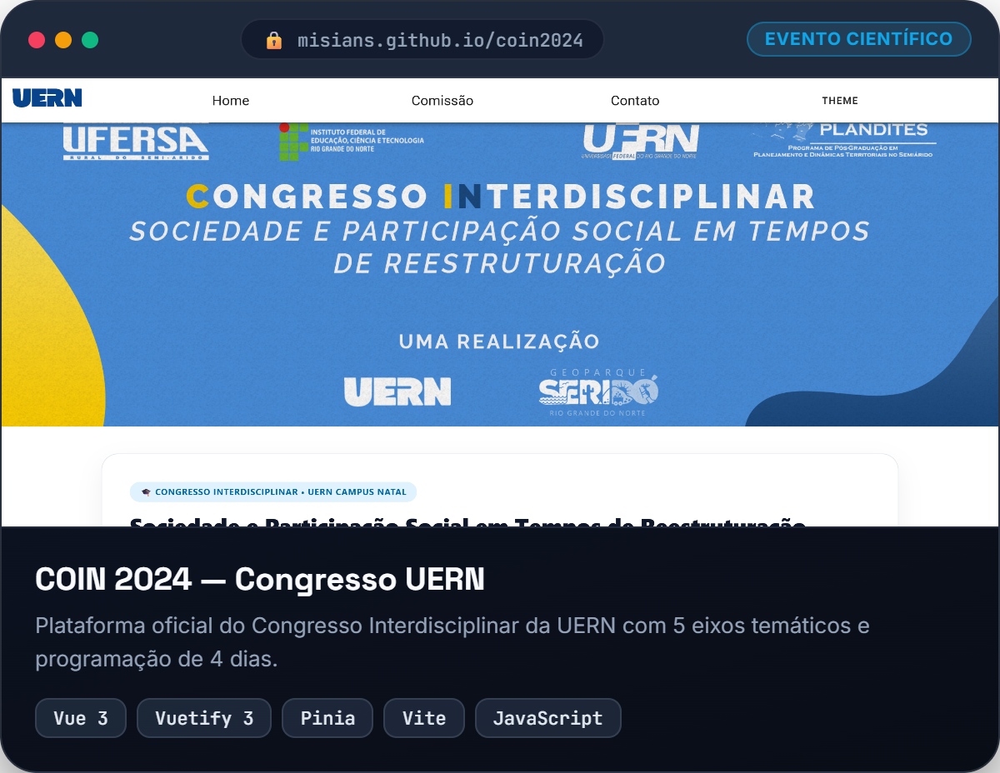</a>
  <a href="https://misians.github.io/respets/">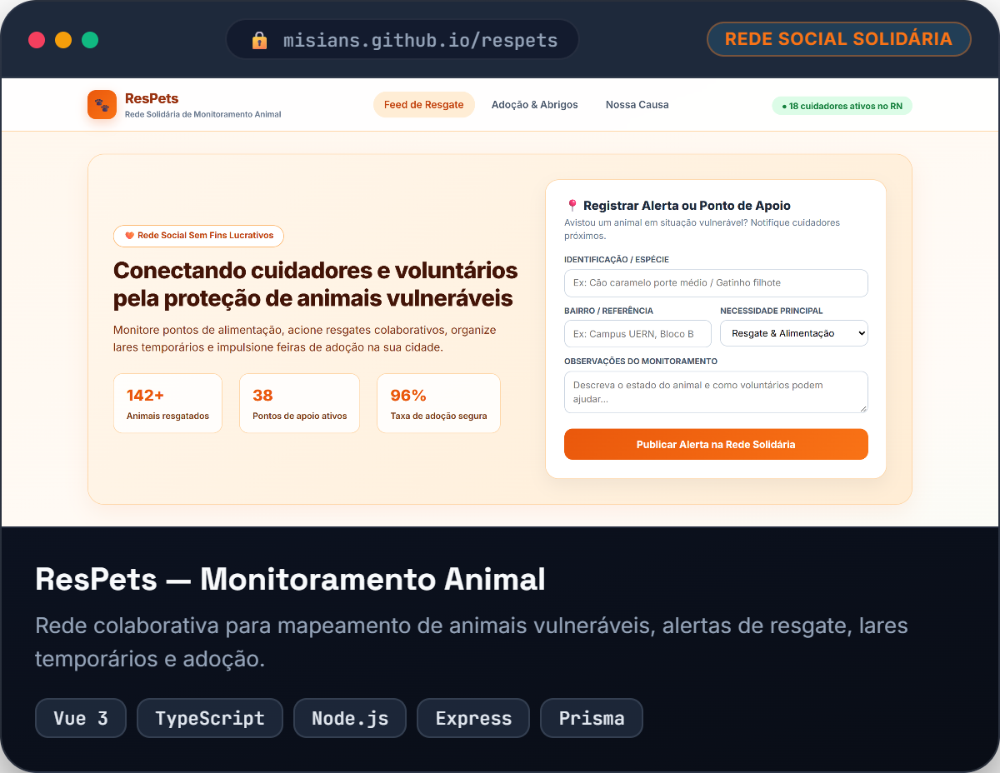</a>

  <a href="https://misians.github.io/nanababy-store/">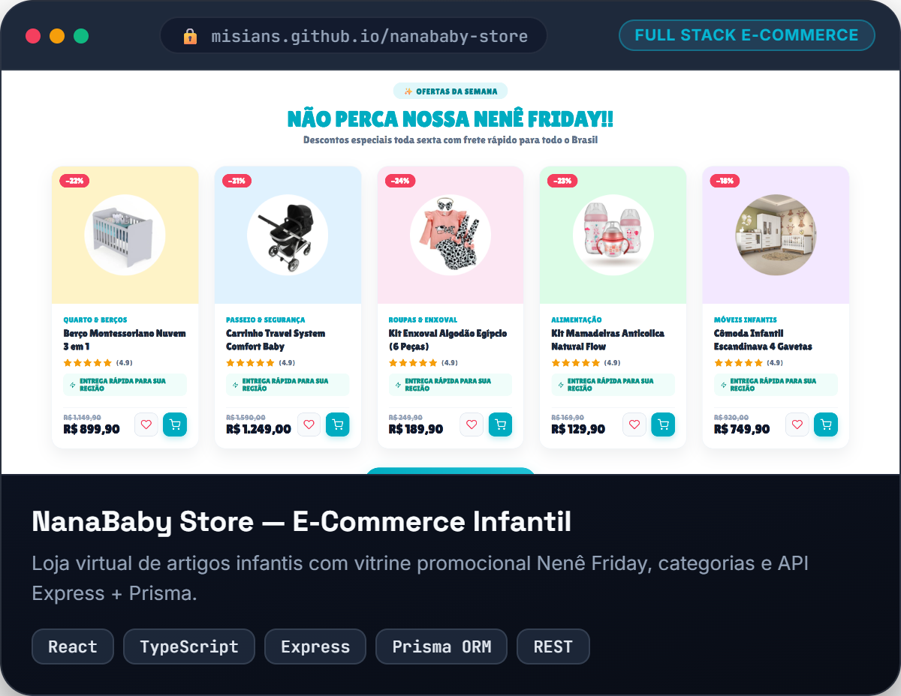</a>
  <a href="https://misians.github.io/GelatoOnIce/">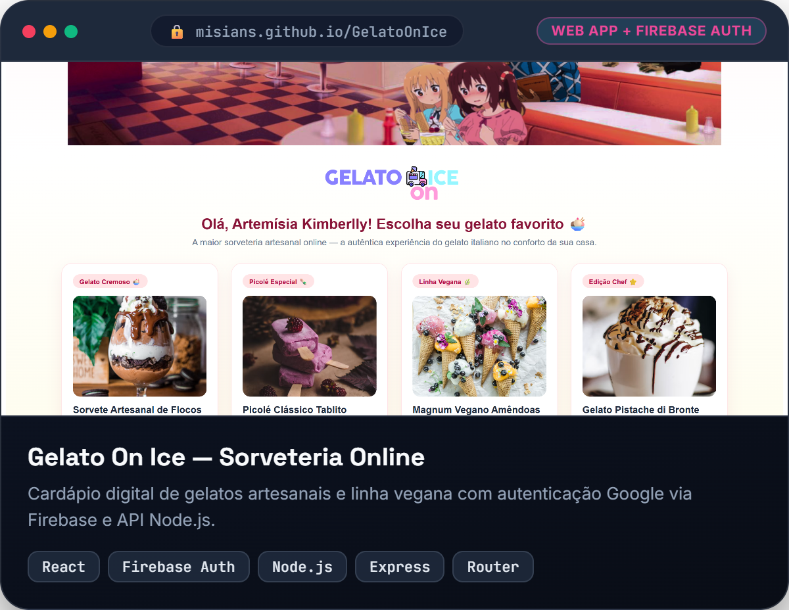</a>

  <a href="https://misians.github.io/FiguresLoja/">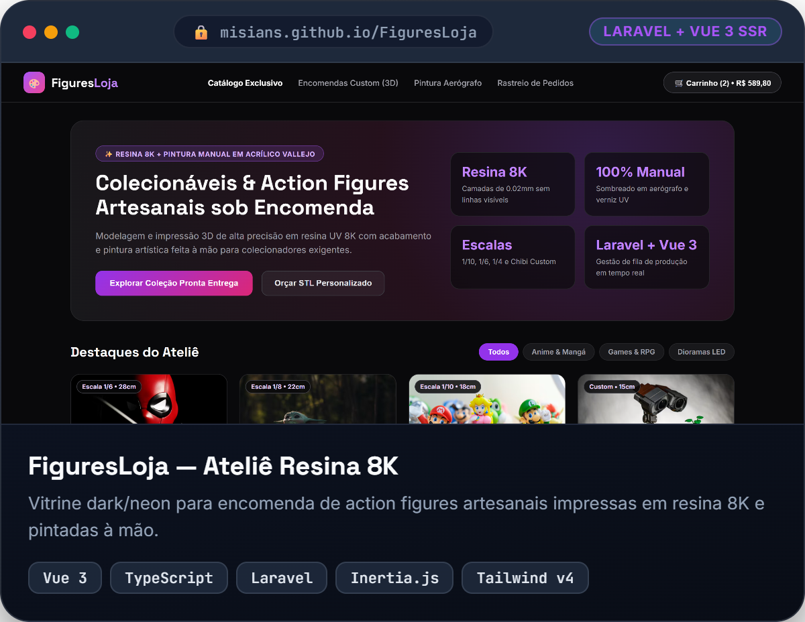</a>
  <a href="https://misians.github.io/Ecommerce-django/">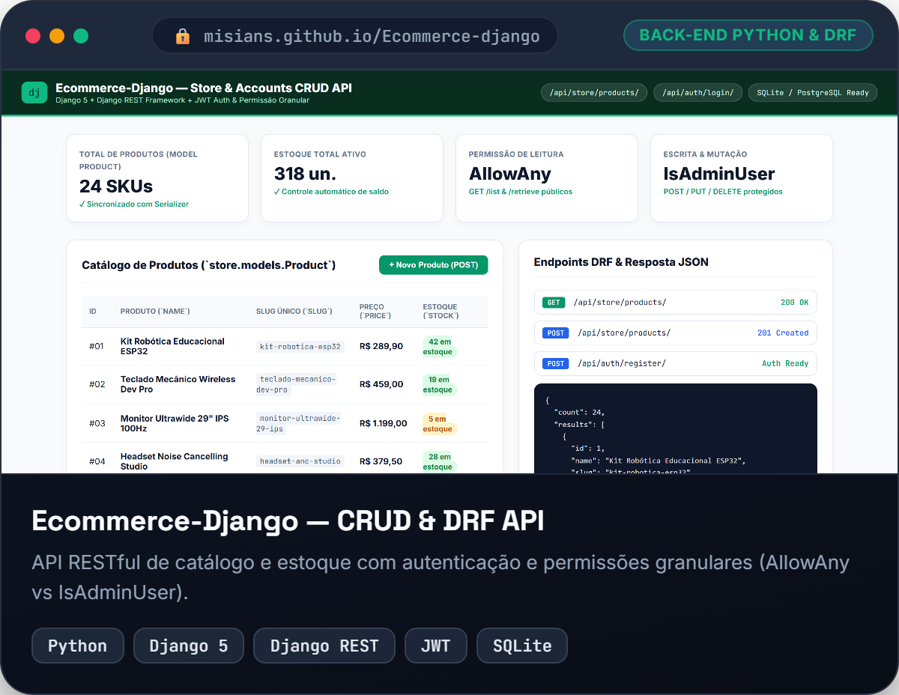</a>

  
  
  
  
  
  

 

### 📚 Produção Científica & Publicações

  <a href="https://orcid.org/0009-0000-9724-4930">
    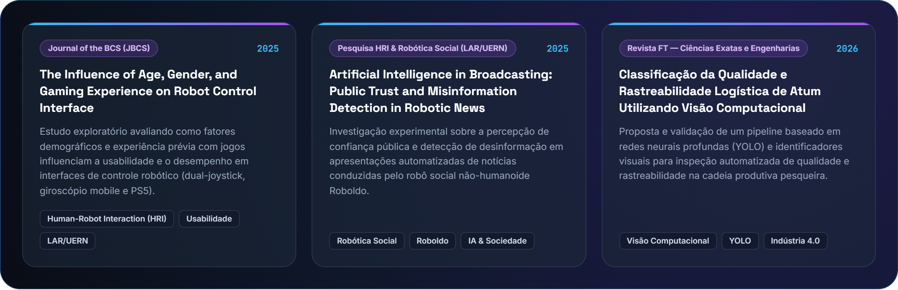
  </a>

 

### 🛠️ Stack Tecnológica & Ferramentas

  

  

  

  
  
  
  
  
  

 

### 📊 Estatísticas no GitHub

 

  

